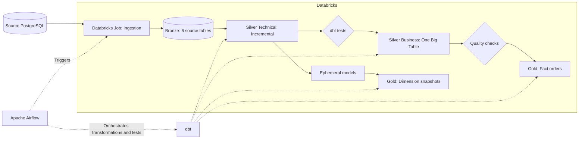

# Walmart Data Engineering Pipeline

Load the source data into **PostgreSQL**, ingest it into the Bronze layer on **Databricks**, and use **Airflow** to orchestrate **dbt** transformations through Silver and Gold.

## Architecture



## Data Models

| Layer | Description |
|---|---|
| Bronze | Six source tables in `walmart.bronze`: `orders`, `customers`, `order_items`, `products`, `stores`, and `employees`. |
| Silver Technical | Six `*_t` models load incrementally using `updated_timestamp`, with an entity-specific unique key and a `processed_at` timestamp. |
| Silver Business | `obt_b` joins orders, order items, customers, products, and stores into one table. Each row represents one order item. |
| Gold Fact | `fact_orders` contains order, order item, product, store, and customer keys, along with `quantity`, `unit_price`, and `line_amount`. |
| Gold Dimensions | Each `eph_*` model reads directly from its Silver entity. Timestamp-based snapshots track historical changes using SCD Type 2. Ephemeral models are inlined into snapshot SQL rather than stored as separate tables. |

Employees are modeled as a separate dimension linked to stores. They are not assigned to fact rows because the source does not identify which employee handled an order.

Use `SUM(line_amount)` for item-level sales and `COUNT(DISTINCT order_id)` for order counts. Order-level `total_amount` is kept in the `dim_order` snapshot rather than repeated in the fact table. To query current snapshot records, filter on the configured `dbt_valid_to` value of `9999-12-31`.

## Orchestration and Data Quality

```text
Ingestion → Clean → Source freshness → Silver Technical → Tests
          → Silver Business → Tests → Dimension snapshots → Fact → Gold tests
```

- Airflow waits for the Databricks job to succeed before running dbt. A failed job fails the task; ingestion has a two-hour timeout.
- `not_null` and `unique` tests check all six Silver entity keys and the order item key in OBT and fact. Missing OBT keys fail validation.
- The order snapshot reads from `orders_t`, keeping one input row per order.
- Source freshness uses `updated_timestamp`, with a warning after 26 hours and an error after 48 hours. This measures business update recency, so rarely updated tables may appear stale even when ingestion succeeds. Adjust thresholds to match the dataset.

## Repository Structure

```text
airflow_dbt_project/
  dags/orchestrate.py       # Pipeline orchestration
  docker-compose.yaml      # Airflow, Redis, and metadata PostgreSQL
  Dockerfile
  walmart_project/         # dbt project mounted into Airflow
walmart_project/           # dbt working copy outside Docker
  models/source/           # Bronze source definitions
  models/silver_t/         # Incremental entity models
  models/silver_b/         # One Big Table
  models/gold/             # Fact, ephemeral models, and tests
  snapshots/               # Dimension history
  tests/                   # SQL data tests
```

## Getting Started

Prepare a source PostgreSQL database, a Databricks workspace, a SQL warehouse, and an ingestion job that loads the six Bronze tables. Loading PostgreSQL and implementing the Databricks ingestion job are handled outside this repository.

1. Copy `airflow_dbt_project/.env.example` to `.env` in the same directory. Set `DATABRICKS_HOST`, `DATABRICKS_TOKEN`, `DATABRICKS_JOB_ID`, and a valid Fernet key.
2. Configure the host, HTTP path, and token environment variable in `airflow_dbt_project/walmart_project/profiles.yml` for your workspace.
3. Start Airflow:

   ```powershell
   cd airflow_dbt_project
   docker compose build
   docker compose up airflow-init
   docker compose up -d
   ```

4. Open `http://localhost:8080`, sign in with the credentials from `.env`, and trigger the `orchestrate` DAG.

Check the dbt connection:

```powershell
docker compose exec airflow-worker bash -lc "cd /opt/airflow/walmart_project && dbt debug"
```
